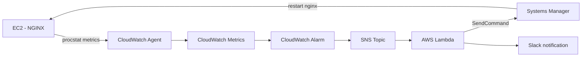

# AWS EC2 Self-Healing Infrastructure


An EC2 web server that detects its own failures and fixes itself. If NGINX crashes, the system restarts it automatically and tells you on Slack, with no human involved.

## Architecture



| Component | Role |
|---|---|
| **EC2 (Amazon Linux 2023)** | Runs the NGINX web server |
| **CloudWatch Agent** | Reports NGINX process count (`procstat`), memory, disk and logs |
| **CloudWatch Alarms** | `nginx-down` (process count < 1) and `status-check-failed` (instance health) |
| **SNS** | Delivers alarm events to Lambda |
| **Lambda (Python 3.12)** | Decides the recovery action and reports the result |
| **Systems Manager** | Runs a custom document: `nginx -t`, restart, health check |
| **Slack** | Success / failure notifications |

## How it works

1. The CloudWatch agent reports `procstat_lookup_pid_count` for `nginx` every 30 seconds.
2. If the count is below 1 for 2 consecutive minutes (or data goes missing), the alarm enters `ALARM`.
3. The alarm publishes to SNS, which invokes the Lambda.
4. Lambda runs the SSM document on the instance and waits for the result.
   If the **status check** alarm fired instead, it reboots the instance.
5. Lambda posts the outcome, duration and command output to Slack.

## Repository structure

```
.
├── terraform/            # All infrastructure (EC2, IAM, SNS, Lambda, alarms, SSM)
├── lambda/               # Recovery function (stdlib + boto3 only)
├── cloudwatch/           # CloudWatch agent config
├── ssm/                  # Systems Manager command document
├── scripts/              # user_data, deploy, destroy, failure simulation
├── tests/                # Lambda unit tests
├── docs/                 # Architecture + troubleshooting
└── .github/workflows/    # CI: tests + terraform fmt/validate
```

## Prerequisites

* AWS account and credentials configured (`aws configure`)
* [Terraform](https://developer.hashicorp.com/terraform/install) >= 1.5
* Optional: a Slack incoming webhook (Slack, then *Apps*, then *Incoming Webhooks*)

## Deploy

```bash
git clone <your-repo-url> && cd aws-ec2-self-healing
cp terraform/terraform.tfvars.example terraform/terraform.tfvars
# edit terraform.tfvars (region, Slack webhook URL)

./scripts/deploy.sh
```

Outputs include the instance ID and the web URL. Open the URL to see the NGINX page.

## Test the self-healing

```bash
./scripts/simulate_failure.sh <instance-id> ap-south-1
```

Within about 2-4 minutes you should see:

1. The `self-healing-nginx-down` alarm go to `ALARM`
2. Lambda logs in `/aws/lambda/self-healing-recovery`
3. An SSM Run Command execution marked *Success*
4. A Slack message: **Recovery successful**
5. The web URL serving the page again

Run the unit tests locally (no AWS needed):

```bash
python -m unittest discover -s tests -v
```

## Security

* No SSH port; shell access only via SSM Session Manager
* IMDSv2 enforced
* Lambda can run only the project's SSM document and reboot instances tagged `SelfHealing=true`
* Slack webhook stored as an SSM `SecureString`
* Tighten `allowed_http_cidr` if the site should not be public

## Cost

A `t3.micro` instance plus detailed monitoring, a few alarms, and Lambda/SNS at near-zero volume costs only a few dollars a month. Check current AWS pricing for your region.

## Cleanup

```bash
./scripts/destroy.sh
```

## Troubleshooting

See [docs/troubleshooting.md](docs/troubleshooting.md).

## Roadmap

- [ ] Auto Scaling Group + ALB for multi-instance HA
- [ ] Email / PagerDuty SNS subscribers
- [ ] CloudWatch dashboard
- [ ] Recovery-attempt limiter (escalate after N failures)
- [ ] HTTP health check via Route 53 / synthetic canary

## License

MIT
