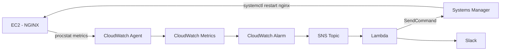

# Architecture

## Design decisions

* **Process-level detection** - the agent `procstat` plugin reports `pid_count` for `nginx`; an EC2 status check alone would miss a crashed process.
* **`treat_missing_data = breaching`** - a dead agent or instance also counts as unhealthy.
* **SNS between alarm and Lambda** - decouples, lets you add email/PagerDuty subscribers later.
* **Custom SSM document** - Lambda can only run that one document, not arbitrary shell commands.
* **No SSH** - port 22 is closed; access is via Session Manager.
* **Secrets** - Slack webhook is an SSM `SecureString`, never in Lambda env vars.
* **IMDSv2 enforced** on the instance.
